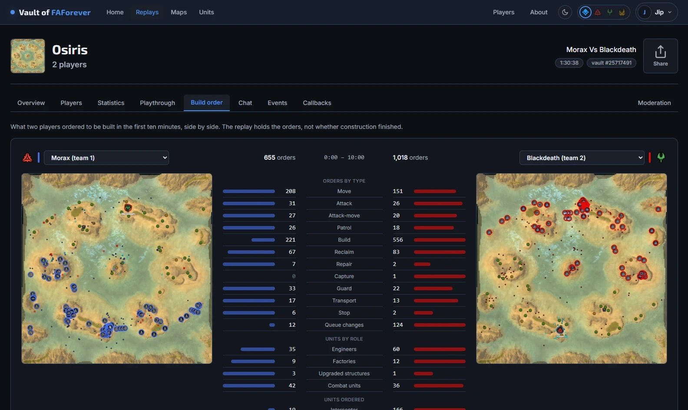
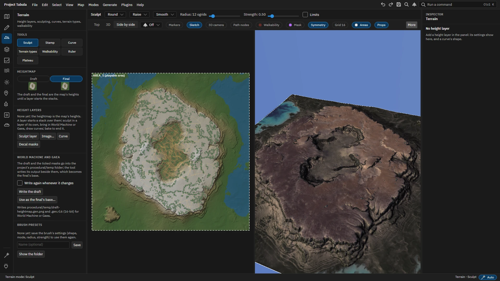

# FAF workshop

Tools for [Supreme Commander: Forged Alliance Forever](https://faforever.com/), the community edition of
[Supreme Commander: Forged Alliance](https://store.steampowered.com/app/9420/Supreme_Commander_Forged_Alliance/):

- **[Vault of FAForever](https://vault.jipwijnia.nl)**, a web app to watch replays again, study maps,
  look up units and follow players. Everything is read in your browser.
- **The map editor**, a desktop application (Windows and Linux) to make maps, from a first sketch to an
  upload to the vault.
- **Libraries** for .NET that read and write the game's files: replays, maps, blueprints, meshes and
  the Lua the game's data is written in.

## Vault of FAForever



Open it at **https://vault.jipwijnia.nl**. It runs in any modern browser, and installs as an app.

- **Replays**: search the FAForever vault by player, map, mod and date, open the replays in your
  computer's replay folder (installed app) or open a single `.fafreplay` or `.scfareplay` file. A replay
  has tabs for its players, statistics, a playthrough of every order on the map, the build orders of
  two players side by side, chat, events, sim callbacks and a moderation log that can be copied as a
  prompt for an AI. Every view is a link to share: tab, filters, time window and selection included.
- **Maps**: the featured maps, the matchmaker's map pools and a search of every map in the vault. A map
  has a page with its terrain, resources, pathing, reclaim, the replays played on it and its reviews.
- **Units**: the units of the base game and of every FAF release since 3603, with filters, comparisons
  and the history of every unit across releases.
- **Players**: profiles with rating history, matches and achievements, the leaderboards, leagues and
  two players compared.
- **About**: explainers for players about how a replay and a blueprint are put together.

Replay, map and unit pages work signed out; searching the vault and the Players pages need an FAF login.

## The map editor



The map editor (beta) keeps a map as a project of JSON and PNG files, so terrain tools, image editors
and git can work on it too, and writes the game's files when you export or upload it.

- **Sketch** a layout first: pencil strokes, symbols, labels and a picture to trace, on sheets.
- **Terrain** in layers you can change later: sculpting, stamps, curves for roads, rivers, ridges
  and cliffs, a draft and a final heightmap for World Machine or Gaea.
- **Paint** the strata by brush, by masks and by rules; water, lighting and the sky.
- **Place** markers, props, decals and units, with symmetry for every edit, presets, palettes and
  units placed in lines, rectangles and rings.
- **Generate** what the map needs: walkability, path networks, the preview, normal and shadow decals.
- **Share** it: export to the game, upload to the vault, or commit to git from the editor.
- **Extend** it with Lua plugins, and drive it from scripts and agents through its automation server.
- Guided tours explain the window; the same tours make [the guide](docs/guide/index.md).

Download it from the [releases](https://github.com/Garanas/faf-workshop/releases): one executable per
system that needs nothing else installed. Every push to `main` builds one as well (the workflow
"Map editor", kept for 90 days). It needs the game and the FAF client's data on the same computer; on
the first start it converts the game's assets into its workspace. Windows and Linux work; the macOS
build has never been started.

## Libraries

The libraries live in `src/` and run on .NET 10, also in the browser (WebAssembly):

| Library | What it reads and writes |
|---|---|
| `FAForever.FileFormats.Replay` | Replays (`.scfareplay` and FAF's compressed `.fafreplay`): the header, every input of every player, and analysis on top. |
| `FAForever.FileFormats.Map` | Maps: the binary `.scmap` (versions 53, 56 and 60), `_save.lua` and `_scenario.lua`, and the navigational mesh of the map. |
| `FAForever.FileFormats.Blueprints` | Blueprints (`.bp`) of units, projectiles, props and effects; blueprint ids, unit names and factions. |
| `FAForever.FileFormats.Mesh` | Meshes of units and props (`.scm`): bones, vertices, triangles, written back or as glTF (`.glb`), and small pictures of them. |
| `FAForever.FileFormats.Lua` | Lua values and an evaluator for the data-only Lua that the game's files are written in. |

The replay parser was inspired by FAForever's
[Java implementation](https://github.com/FAForever/faf-java-commons/blob/develop/faf-commons-data/src/main/java/com/faforever/commons/replay/ReplayLoader.java).

## Building and running

You need the [.NET 10 SDK](https://dotnet.microsoft.com/download).

```sh
dotnet build FAForever.sln                                  # everything
dotnet test FAForever.sln                                   # every test project
dotnet watch --project src/FAForever.Vault.Server           # the vault on http://127.0.0.1:5080
dotnet run --project src/FAForever.MapEditor.App            # the map editor
```

The vault's styles are made with the Tailwind CSS standalone CLI: run `pwsh tools/install-tailwind.ps1`
once, and the build regenerates the stylesheet. The map editor comes with `faf-map`
(`src/FAForever.MapEditor.Cli`), which turns a map folder into a project and back:

```sh
faf-map unpack maps/theta_passage.v0004 theta_passage       # a map folder into a project
faf-map pack theta_passage "<game>/maps" --version 5        # a project into maps/theta_passage.v0005
faf-map pack theta_passage "<game>/maps" --watch            # pack again on every change
```

[AGENTS.md](AGENTS.md) and the guides in each project hold the architecture, conventions and the
FAForever endpoints the vault uses; [TODO.md](TODO.md) lists open items.

## Performance

The replay parser is benchmarked with [BenchmarkDotNet](https://benchmarkdotnet.org/), as a whole: in
practice a replay is always parsed as one unit. Every replay in `assets/faforever` is part of the benchmark.

_Benchmark data from 2024/09/04_

| ReplayFile           | Mean      | Error     | StdDev    | Gen0      | Gen1      | Gen2      | Allocated |
|--------------------- |----------:|----------:|----------:|----------:|----------:|----------:|----------:|
| 23225104.fafreplay   | 17.290 ms | 0.3406 ms | 0.2844 ms | 1218.7500 | 1187.5000 |  968.7500 |  29.06 MB |
| 23225323.fafreplay   |  5.238 ms | 0.0730 ms | 0.0683 ms | 1078.1250 | 1062.5000 | 1000.0000 |  12.07 MB |
| 23225440.fafreplay   |  2.438 ms | 0.0205 ms | 0.0192 ms |  539.0625 |  535.1563 |  496.0938 |   4.12 MB |
| 23225508.fafreplay   |  1.056 ms | 0.0205 ms | 0.0182 ms |  261.7188 |  259.7656 |  248.0469 |   1.65 MB |
| 23225685.fafreplay   |  6.138 ms | 0.0548 ms | 0.0512 ms | 1093.7500 | 1085.9375 | 1000.0000 |  12.94 MB |

## References

The libraries use the latest of C#, learned from books and online education:

- [Zoran Horvat](https://www.youtube.com/@zoran-horvat)
- [dotnet](https://www.youtube.com/@dotnet), in particular
  [A Complete .NET Developer's Guide to Span with Stephen Toub](https://www.youtube.com/watch?v=5KdICNWOfEQ)
- [Raw coding](https://www.youtube.com/@RawCoding), in particular
  [Understanding .NET C# Heaps (Deep Dive)](https://www.youtube.com/watch?v=TnDRzHZbOio)

And documentation:

- [BenchmarkDotNet](https://benchmarkdotnet.org/articles/overview.html): its
  [diagnosers](https://benchmarkdotnet.org/articles/configs/diagnosers.html) and
  [the memory diagnoser](https://adamsitnik.com/the-new-Memory-Diagnoser/)

## Credits

With thanks to:

- https://github.com/JoschiZ for casually helping a stranger with Blazor struggles on Discord

## License

[MIT](LICENSE).
