# A tour of the Markers mode

[All tours](index.md)

Spawns, mass and hydrocarbon deposits, path nodes and chains, with one deposit placed by you.

## 1. Markers

Markers are the points the game reads from the map: where each army starts, where the mass and hydrocarbon deposits lie, the path nodes the AI follows, and places a script can point at. About ten steps. You will place one deposit yourself; Undo takes it away again.

## 2. The panel lists the markers

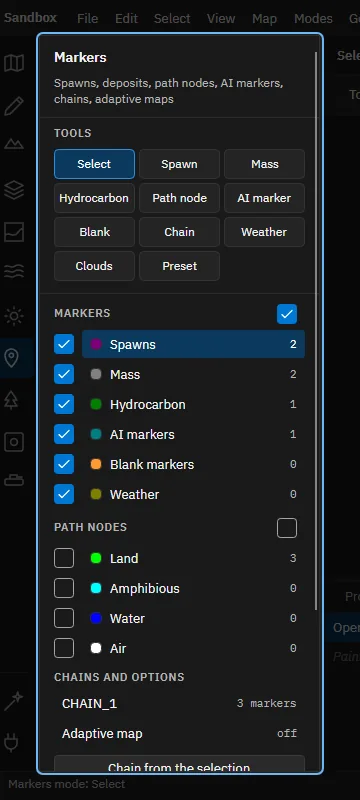

One row for each kind of marker with how many the map has, then the path nodes by layer, then the chains. The check box at the left of a row shows or hides that kind in the views. Choose a row to see it in the inspector.

## 3. The tools

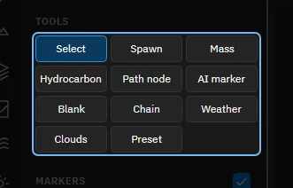

Select picks markers. Spawn, Mass, Hydrocarbon, AI marker and Blank place one marker per click. Path node lays a path, Chain joins markers in an order, Weather and Clouds place weather, and Preset places a saved group of markers.

## 4. Try it: choose the Mass tool

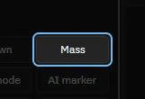

Click Mass in the list of tools.

> The Mass tool is active. Its settings are in the row above the views.

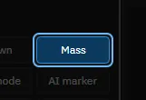

## 5. Try it: place a mass deposit

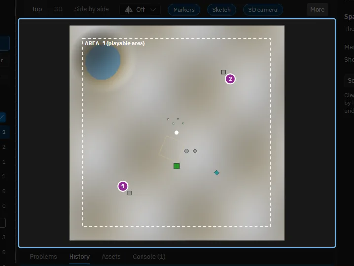

Click on the map. The deposit goes to the middle of the nearest ogrid, as the game puts it, and gets the next free name.

> That is one deposit, one step of Undo. It is selected, so the inspector shows it.

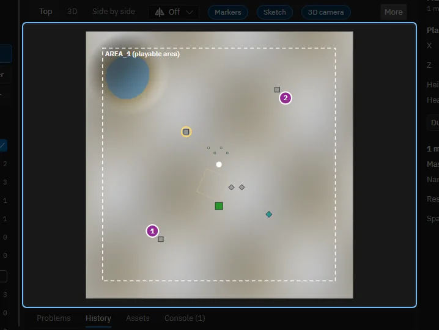

## 6. The inspector edits the marker

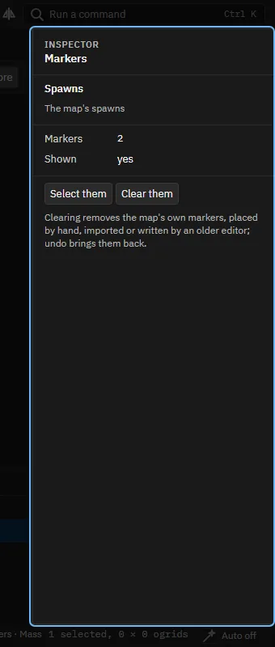

What you selected last: the deposit's name and resource, and for other kinds the army of a spawn, the type of an AI marker or the layer of a path node. A field changes every selected marker at once.

## 7. The tool's settings

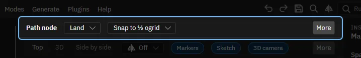

Spawns, AI markers and path nodes can snap to a grid, and a path node has its layer: land, amphibious, water or air. Deposits always snap to an ogrid's centre. A deposit on steep ground gets a warning here and in the status bar.

## 8. Paths of nodes

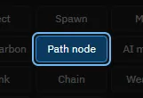

With the Path node tool a click on empty ground places a node linked to the selected one, so clicks lay a path. Drag from one node to another to link them. Nodes of different layers never link. The Procedural mode can also generate a whole network for you.

## 9. Chains and the adaptive map

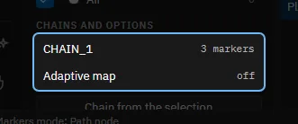

A chain is a list of markers in an order, for scripts. Select markers and use Chain from the selection, or click them one by one with the Chain tool. The adaptive map entry makes deposits wait for the army that starts nearest.

## 10. A kind in the inspector

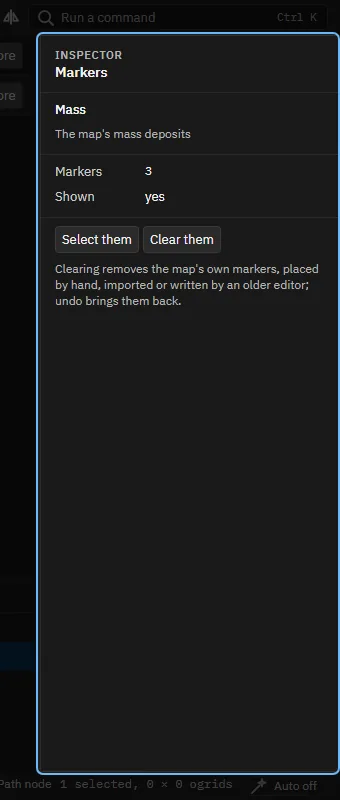

Choosing the row Mass in the list shows how many there are, with Select them and Clear them. Clearing is one step of Undo.

## 11. Showing markers in the views

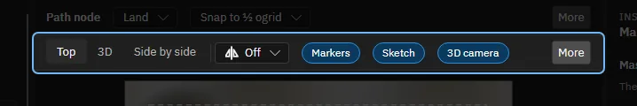

The chips above the views switch the Markers overlay on and off (Path nodes too, behind More when the window is narrow). Choosing a marker tool shows its kind on its own.

## 12. That is the Markers mode

Spawns also make the armies, so the Units mode places each army's first base. Help, Tours starts this tour again and lists the others.

Made with the map editor 1.0.0+0b2734474d350fcba68c3bdae8a6574fef65815c on 2026-10-13, window 1280 by 800, dark theme.
