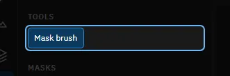
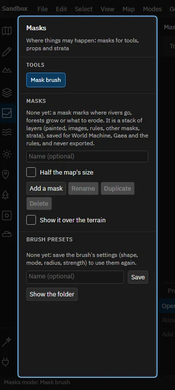
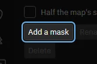
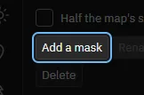
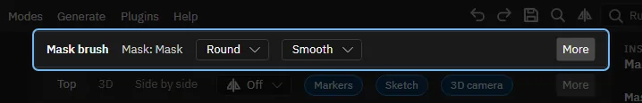
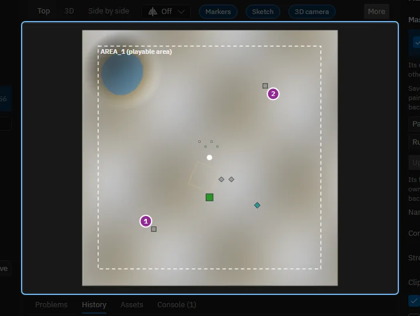
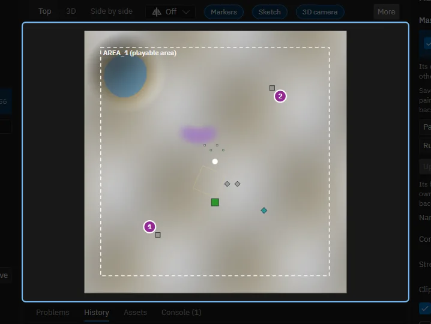
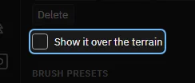
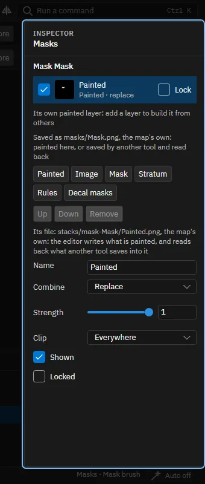

# Masks: where things may happen

[All tours](index.md)

Make a mask of your own, paint it, build it from layers and rules, and see where it is used.

## 1. Masks

A mask is a picture of the map that says where something may happen: where rivers go, where forests grow, what to erode. Height layers, strata and prop rules read masks. Ten steps.

## 2. The mask brush

The mask brush paints the chosen mask. It is the one tool of the mode.

## 3. The list of masks

Each mask has a small picture that follows your strokes, and its size. Choose one to paint it and to edit it in the inspector. Under the list: a name field, Add a mask, Rename, Duplicate, Delete, and Show it over the terrain.

## 4. Try it: add a mask

Type a name if you like, then click Add a mask. A mask starts empty. Half the map's size makes a coarser mask, which is enough for most uses.

> The new mask is in the list and chosen. Delete removes it again, and so does undo.

## 5. The brush's settings

The chosen mask's name, the brush shape and how its edge fades, the radius and the strength, and Erase, which takes the mask away instead of adding it.

## 6. Try it: paint a mask

Press the left mouse in the top view and drag over the map. The painted part shows in colour over the terrain. Each stroke is one step of undo. A mask has to be chosen in the list first; add one if the list is empty.

> The painted part shows in colour. Ctrl+Z takes the stroke back.

## 7. Seeing the mask

Show it over the terrain keeps the chosen mask visible, also when another tool is active. The chip Mask above the views does the same.

## 8. A mask is a stack of layers

The inspector lists the layers of the chosen mask. A layer can be painted, an image, another mask, a stratum's mask, or rules. Each has a way of combining with the layers below, a strength and a clip. Up, Down and Remove arrange them. A rules layer builds a mask without painting: it follows the terrain by slope, height, distance from the water or noise, so grass on flat ground needs no brush.

## 9. Where masks are used

A height layer takes a mask as its clip, so it works only there. A stratum's layer can read a mask, and props can be placed by rules from one. Masks are for your tools: the game never gets them.

## 10. That is the Masks mode

Next: the Paint mode, where strata give the terrain its textures. Help, Tours lists it.

Made with the map editor 1.0.0+0b2734474d350fcba68c3bdae8a6574fef65815c on 2026-10-13, window 1280 by 800, dark theme.
