# Painting the terrain's strata

[All tours](index.md)

The terrain's textures: strata, their masks, the strata brush and the 3D view.

## 1. Painting strata

The terrain's looks are strata: a texture each, laid over the one below, and a mask that says where it shows. The Paint mode picks the textures and paints the masks. Thirteen steps.

## 2. The strata brush

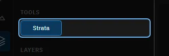

The Strata tool paints the mask of the chosen stratum. Where the mask is full, that stratum's texture covers the ones below.

## 3. The layers

From the bottom: the lower layer covers the whole map, then strata 1 to 8, then the upper layer, which lies over everything. Each row shows the texture and the stratum's mask. Unused strata are empty.

## 4. Try it: choose a stratum

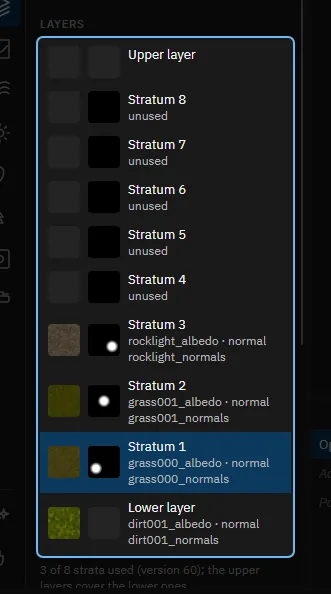

Click Stratum 2 in the list. The strata brush paints the stratum you chose.

> The map shows Stratum 2's mask in colour, and the inspector shows its textures.

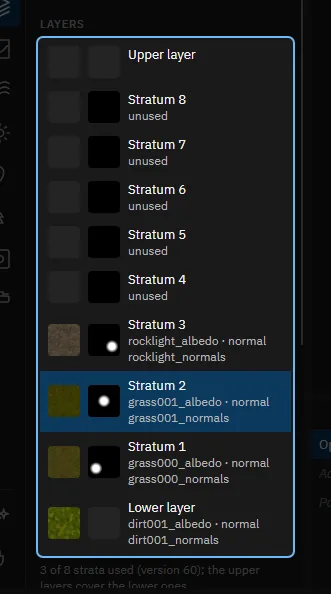

## 5. The stratum's textures

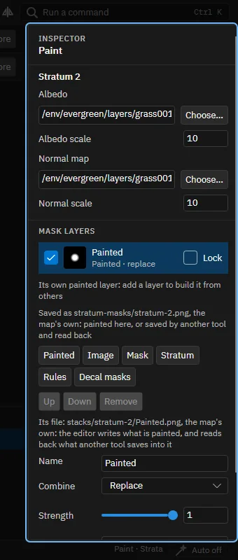

The albedo is the texture's colour and the normal map its relief, each with a scale: a smaller scale repeats the texture more often. Choose... picks a texture from the game's files and your own.

## 6. The brush's settings

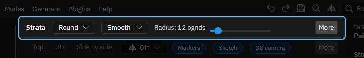

Shape, edge and radius, and under More the strength and Erase. Slope and Height limit the brush to ground whose slope or height is within the range you set, such as rock only on steep ground.

## 7. Try it: paint one stroke

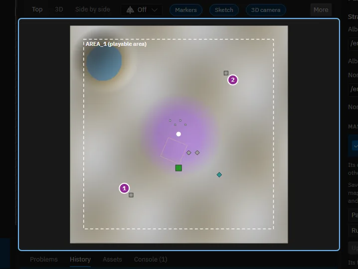

Press the left mouse in the top view and drag over the map to paint the stratum's mask; with Erase on, the brush removes it. Each stroke is one step of undo; with symmetry on it paints every part of the map.

> The stratum's mask is painted where you dragged. Ctrl+Z takes the stroke back.

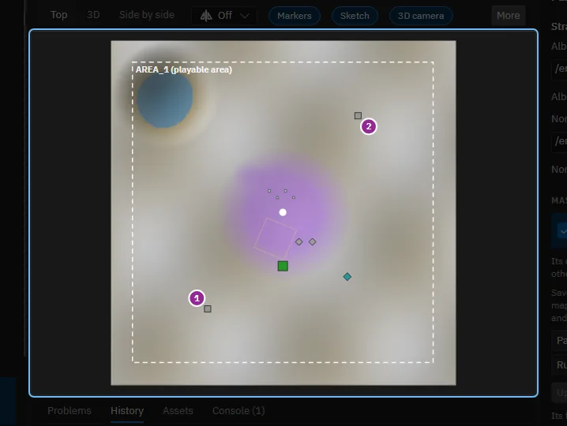

## 8. A stratum's mask is a stack

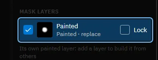

Under Mask layers: the painted layer, and more layers that are an image, another mask, another stratum or rules, each combined with the ones below. Use them to build a mask from the terrain instead of painting all of it.

## 9. Rules from the terrain

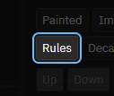

A rules layer makes the mask from slope, height, distance from the water or noise. Grass on flat ground and rock on slopes need no painting, and the mask follows the terrain when you sculpt it.

## 10. Adding and ordering strata

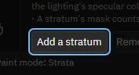

Add a stratum takes the next free one, Remove takes the chosen one out, and Up and Down change its order: the higher a stratum, the later it is laid over the others. The map's version sets how many there are.

## 11. The terrain shader

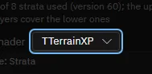

The shader decides how the game lays the strata together. Forged Alliance's has eight strata. The notes under it say what the game reads from each texture.

## 12. Try it: see it in 3D

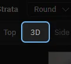

Click 3D to see the textures as the game draws them.

> The terrain is drawn with its strata. Both views share the camera.

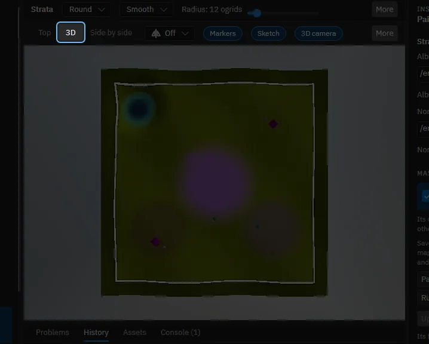

## 13. That is the Paint mode

Help, Tours lists the tour of the window and the others.

Made with the map editor 1.0.0+0b2734474d350fcba68c3bdae8a6574fef65815c on 2026-10-13, window 1280 by 800, dark theme.
