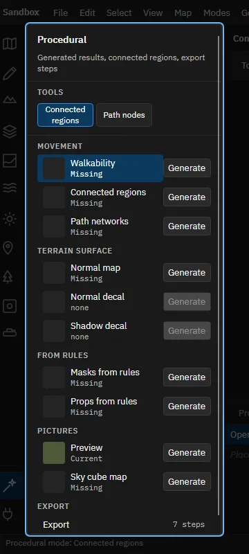
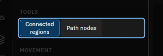
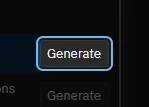
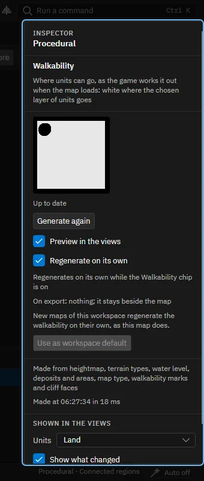
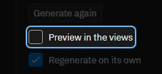
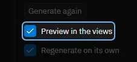
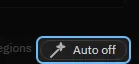
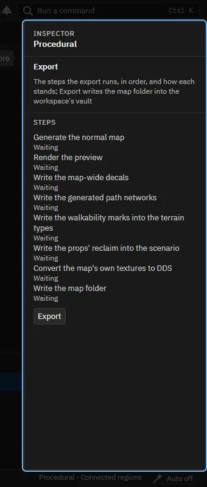
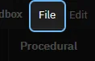

# A tour of the Procedural mode and the export

[All tours](index.md)

Results the editor works out from the map, the steps of the export, and where to find Export and Upload to the vault.

## 1. Procedural

Some of what a map needs is worked out from the rest of it: where units can walk, the paths of the AI, the normal map, the preview. This mode lists those results. It ends with the export, which writes the map for the game. About twelve steps; nothing is exported.

## 2. The results

One row for each result, under Movement, Terrain surface, From rules and Pictures. Each says how it stands: Missing, Out of date or Current. Generate makes it. Export is the last row.

## 3. Two tools

Connected regions chooses a region of ground that units can travel between by clicking it. Path nodes edits the generated path network by hand: click to add a node, drag to move or link.

## 4. Try it: generate the walkability

Press Generate beside Walkability. It marks where land, air and water units can go, as the game works it out.

> The walkability is Current. Generating changes nothing in the map's own data, so there is no step of Undo.

## 5. The inspector

For the chosen result: how it stands, Generate, whether the views preview it, whether it regenerates on its own, what it is made from, and what the export does with it.

## 6. Try it: see the result

Tick Preview in the views, or the Walkability chip above the views.

> The top view now tints where units cannot go.

## 7. Regenerating on its own

While a result is shown in the views, the editor makes it again after you change what it is made from, a second later. This switch turns that off for the whole editor; each result has its own choice in the inspector.

## 8. The export

This is the Export row. The inspector lists the steps the export takes, in order: the normal map when it is out of date, the preview picture, the decals and path networks you chose to write, the walkability marks, the reclaim totals, the textures as DDS files and last the map folder. Each shows waiting, running, done or failed. Its Export button runs them.

## 9. File, Export to the vault

File, Export to the vault (Ctrl+E) runs those steps and writes the map folder for the game into the workspace's vault folder. It works on a copy: your project and its generated results stay as they are. This tour does not export; choose it yourself when you are ready.

## 10. File, Upload to the vault

File, Upload to the vault sends the map to the FAForever vault. It runs the checks, exports the next version, asks you to confirm, signs you in through your browser and uploads. The Sandbox cannot be uploaded: a map needs its own name and description first.

## 11. That is the Procedural mode

Help, Tours starts this tour again and lists the others.

Made with the map editor 1.0.0+0b2734474d350fcba68c3bdae8a6574fef65815c on 2026-10-13, window 1280 by 800, dark theme.
