# Drafting a map

[All tours](index.md)

Sketch a map before you build it: pencil strokes, symbols, labels, sheets and a picture to trace.

## 1. Drafting a map

No idea where to begin? Draw first and build later. A sketch is a draft on top of the map: rough lines, symbols and words that never reach the game. Fourteen steps. Back and Next go through them; Escape ends the tour.

## 2. The Sketch mode

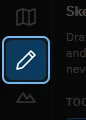

This button on the rail, or F10, opens the Sketch mode. It sits first because a draft comes first. The sketch is kept in the project, shows in every mode to guide the work, and is never exported.

## 3. The tools

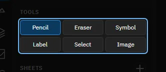

Pencil draws lines. Eraser rubs them out. Symbol stamps a small sign: a spawn, a mass point and the like. Label writes words. Select picks, moves and recolours what you drew. Image shows a picture of your own to trace.

## 4. Try it: draw a line

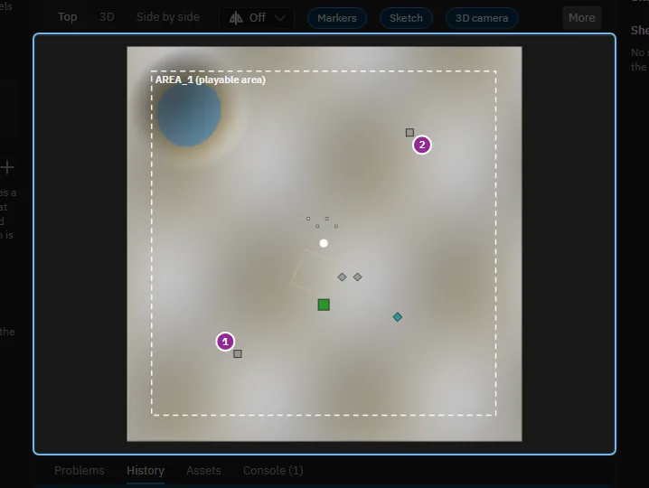

Press the left mouse in the map and drag, then let go. A click makes a dot; Shift makes a straight line.

> That line is one stroke. The first stroke made a sheet for it. Ctrl+Z takes it back.

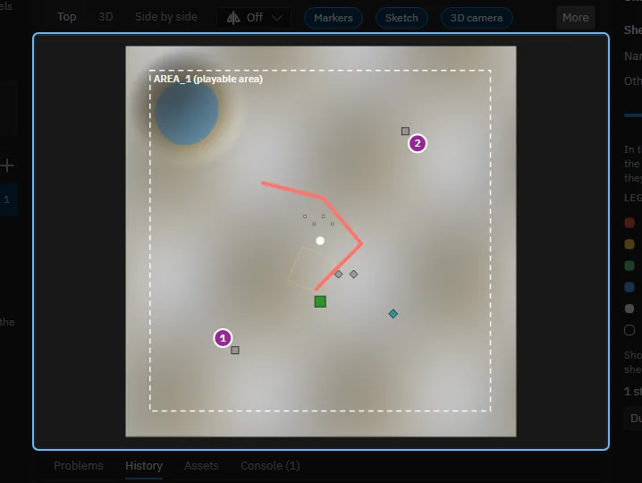

## 5. Colours and widths

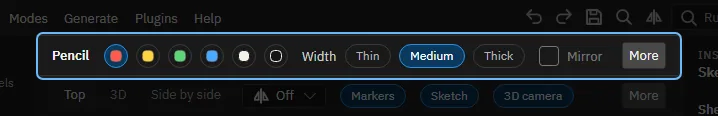

Six colours: red, yellow, green, blue, white and black. The keys 1 to 6 choose one. The width is Thin, Medium or Thick (behind More when the window is narrow); the keys [ and ] make it smaller and larger. Choose before you draw, as with a pen.

## 6. Mirror and the map's symmetry

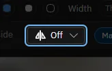

A map for two teams is usually the same on both sides. Choose the map's symmetry here, and the Mirror box of the pencil, the eraser and the Symbol tool repeats each stroke and symbol on the other side. Mirror stays off until the map has a symmetry.

Mirror is the tool's own wish; the symmetry itself is chosen once for the map, in this box beside the views.

## 7. Sheets and the legend

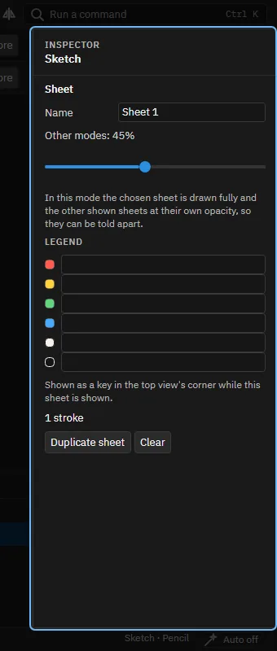

A sheet is a layer of the sketch: one for the spawns, one for the water, one for a second idea. Add one with + in the panel, and show, hide or clear each on its own. Here you name the sheet, set how faint it is in the other modes, and write its legend: what each colour means on this sheet.

## 8. Try it: stamp a symbol

The row above holds six: a spawn, a mass point, a hydrocarbon point, an arrow, a cross and a question mark. Click in the map to stamp the chosen one.

> The symbol is on the sheet. Ctrl+Z takes it back.

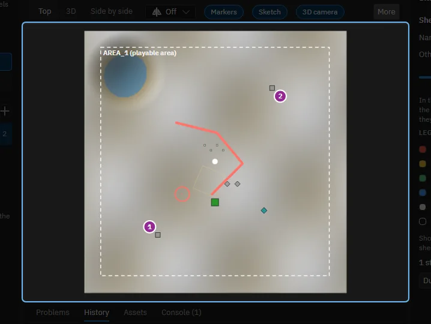

## 9. Labels

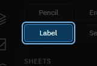

With Label, click in the map and type: a name for a lake, a note about an expansion, a question to answer later. Enter keeps it. Its colour and size are in the row above.

## 10. The eraser

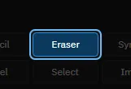

Drag it over a line to rub out the part it passes; the rest stays. Hold Alt to take away whole strokes, symbols and labels instead. A drag is one step of undo.

## 11. Projected images

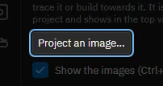

Project an image... asks for a picture file: a drawing, a photo, a screenshot of another map. It is copied into the project and laid over the top view, to trace or to build towards. You can move, turn, scale and fade it, and have several. Images show in the top view only; Ctrl+Shift+J shows or hides them. The tour opens no files: press the button when you have a picture.

## 12. Showing the sketch

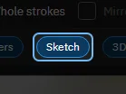

The Sketch chip turns the sketch on or off in every mode, as does Ctrl+Shift+K. Hide it to see the map as it is, show it to build along the draft.

## 13. The sketch in 3D

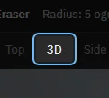

Strokes, symbols and labels lie on the ground in the 3D view too, and climb the hills. You can draw and stamp there as in the top view. Projected images stay in the top view.

## 14. A draft to build from

Next: the tour of the Terrain mode, which turns a draft into ground. Help, Tours lists it and starts this one again.

Made with the map editor 1.0.0+0b2734474d350fcba68c3bdae8a6574fef65815c on 2026-10-13, window 1280 by 800, dark theme.
