# Shaping the terrain

[All tours](index.md)

Sculpt the ground in layers you can change later: tools, brushes, height layers and undo.

## 1. Shaping the terrain

The Terrain mode shapes the ground: where it rises, falls and where units can walk. Twelve steps. Back and Next go through them; Escape ends the tour.

## 2. The tools

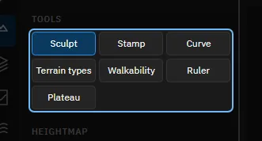

Sculpt raises and lowers with a brush. Stamp presses a picture into the ground. Curve draws roads, rivers, ridges and cliffs along a line. Terrain types sets what the game uses for footsteps and effects. Walkability marks by hand where land units may go. Ruler measures distance and slope.

## 3. Try it: choose Sculpt

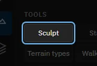

Click Sculpt.

> Sculpt is the tool for the general form of the map.

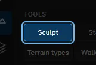

## 4. The brush

The shape of the brush, what it does (raise, lower, smooth, flatten, set a height, noise, erode, scale), how its edge fades, its radius and its strength. More holds the rest. The keys [ and ] make the brush smaller and larger.

## 5. Try it: make one stroke

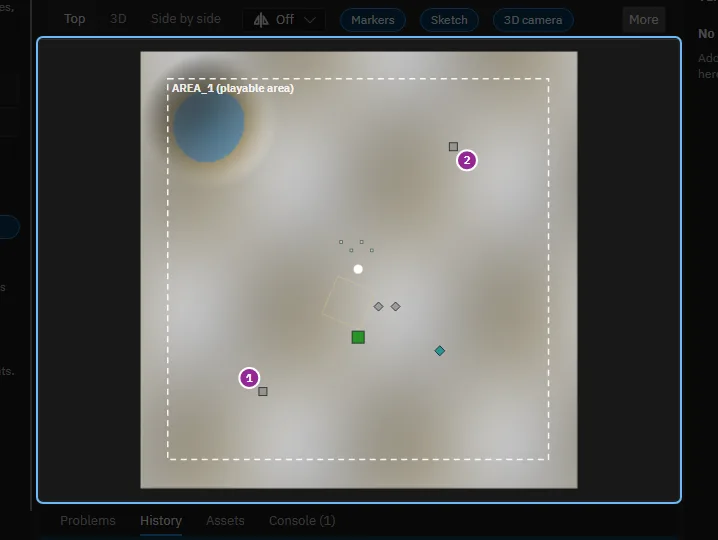

Press the left mouse in the top view and drag over the map to raise the ground. Every stroke is one step of undo (Ctrl+Z). With symmetry on, the stroke is made in every part of the map.

> The ground rose where you dragged. Ctrl+Z takes the stroke back.

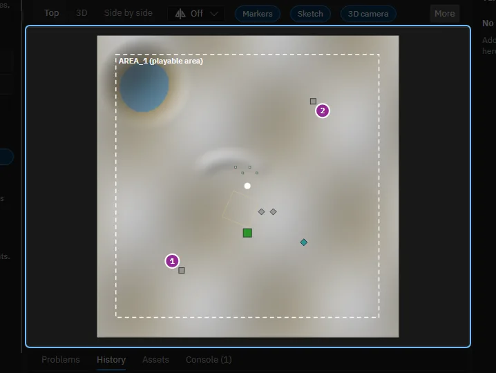

## 6. Draft and final

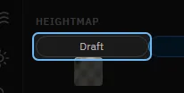

A map can have two heightmaps. The draft is the rough shape you send to a tool such as World Machine or Gaea. The final is the one the game gets. The chips choose which one the views show and the brushes change.

## 7. Try it: add a height layer

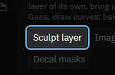

A height layer is a change on top of the ground below it. Click Sculpt layer to add one. The Sculpt tool then writes into the chosen layer, so you can hide, lock, weaken or remove what you sculpted later.

> The layer is in the list under Height layers. Strokes now go into it.

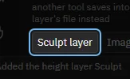

## 8. The layers

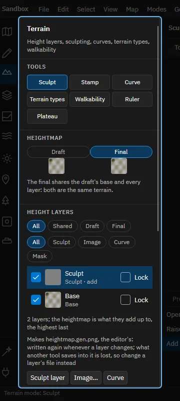

The highest layer is first. Each row has a box to show or hide the layer, a small picture, its name and how it combines, and a lock. The chips above the list filter it. Under it, Sculpt layer, Image and Curve add more, and Bake ends the stack.

## 9. The layer's settings

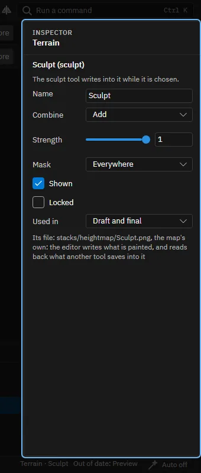

The inspector edits the chosen layer: its name, how it combines with the layers below (add, subtract, multiply and more), its strength, a mask that limits where it works, whether it is shown or locked, and whether it counts for the draft, the final or both.

## 10. Curves

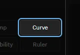

The Curve tool makes a layer from a line. Click points on the map to draw it and choose its profile: a road, a river, a ridge, a valley or a cliff. Drag a point to move it. The inspector then holds the width, falloff and height.

## 11. Everything can be undone

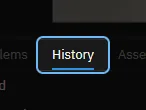

History lists every step. Ctrl+Z undoes the last one, Ctrl+Y does it again, and a click on a step goes back to it. Strokes made in this tour are in the list too.

## 12. That is the Terrain mode

Next: the Masks mode, which marks where things may happen, and the Paint mode. Help, Tours lists them.

Made with the map editor 1.0.0+0b2734474d350fcba68c3bdae8a6574fef65815c on 2026-10-13, window 1280 by 800, dark theme.
