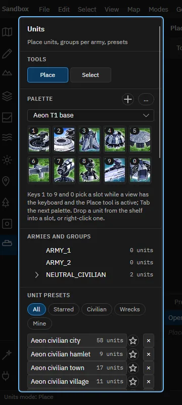
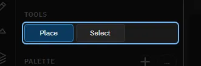
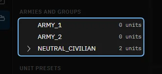
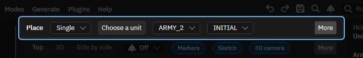
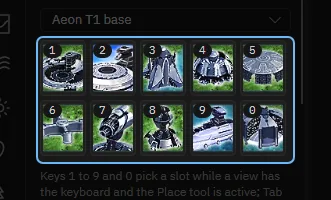
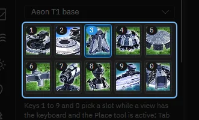
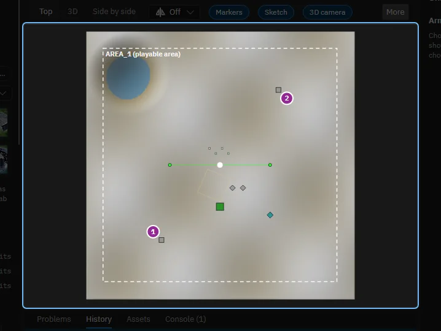
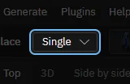
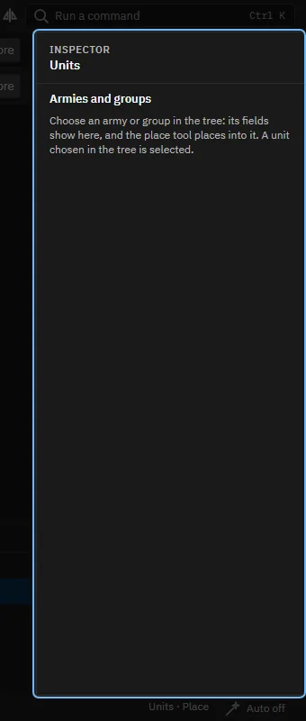
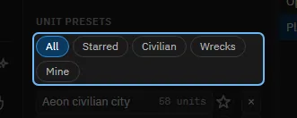

# A tour of the Units mode

[All tours](index.md)

Armies, groups and units: the palette, placing one unit, placing many, and presets.

## 1. Units

The Units mode puts units on the map: each army's starting base, civilians, and wrecks. About ten steps. You will place one unit yourself; Undo takes it away again.

## 2. The mode's panel

The tools, a palette of ten slots to place from, the armies with their groups, and below them presets: ready-made settlements and wreck fields.

## 3. Two tools

Place puts a unit where you click. Select picks units to move, turn, group or delete. Double click a unit to select its whole group.

## 4. The palette

Ten slots of units you place often. Keys 1 to 9 and 0 pick a slot while the mouse is over a view; Tab changes the palette. A unit tile dragged from the Assets tab onto a slot keeps it there.

## 5. Armies and groups

Every army has groups. INITIAL holds the units the game creates at the start, WRECKAGE the wrecks. The group you choose here is where the Place tool puts units. Choose an army or a group to edit it in the inspector.

## 6. The Place tool's settings

How to place, the unit, its army and its group come first. Behind More are the facing, the spacing and As wrecks. Q and E turn what you place.

## 7. Try it: choose a unit

Click slot 3, the Mass Extractor. The Place tool then places that unit.

> The Place tool has the Mass Extractor. Choose a unit is the other way: it opens the picker with every unit of the workspace.

## 8. Try it: place the unit

Click on the map. A structure snaps to the build grid.

> That is one unit, one step of Undo. Its army is the one whose spawn lies nearest the middle of the view.

## 9. Many at once

Single places one unit. Line and Rectangle are dragged out, Ring surrounds the selected structures, and Scatter paints units in a circle. The footprints show under the mouse before you click, in red where they would overlap.

## 10. The inspector edits the units

Edits what you chose last. A unit picked with the Select tool shows its army, group and blueprint, Replace, the faction chips, Group, Ungroup and the Wrecks check box. An army or group chosen in the tree shows its name, its units and Add a group. The unit the Place tool has shows on its tile.

## 11. Unit presets

A preset is a saved group of units. The editor ships villages, farms and wreck fields; Save keeps your own. Click a preset to choose it, then click on the map to place it as a new group.

## 12. That is the Units mode

The Map mode holds the armies' teams and factions. Help, Tours starts this tour again and lists the others.

Made with the map editor 1.0.0+0b2734474d350fcba68c3bdae8a6574fef65815c on 2026-10-13, window 1280 by 800, dark theme.
