# A tour of the window

[All tours](index.md)

The parts of the editor's window, in about two minutes.

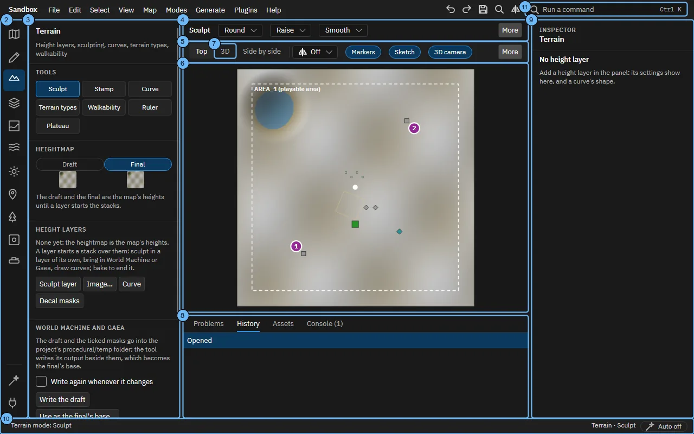

## 1. A tour of the window

Twelve steps, about two minutes. Back and Next go through them; Escape ends the tour, and Help, Tours starts it again.

## 2. The modes

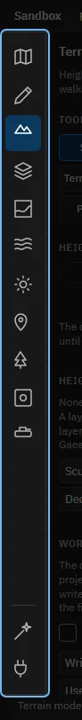

Each mode is one kind of work: the map's settings, sketches to draft it, the shape of the terrain, its paint and masks, water, lighting, markers, props, decals and units. F1 to F12 choose them; Procedural and Plugins sit at the bottom.

## 3. The mode's panel

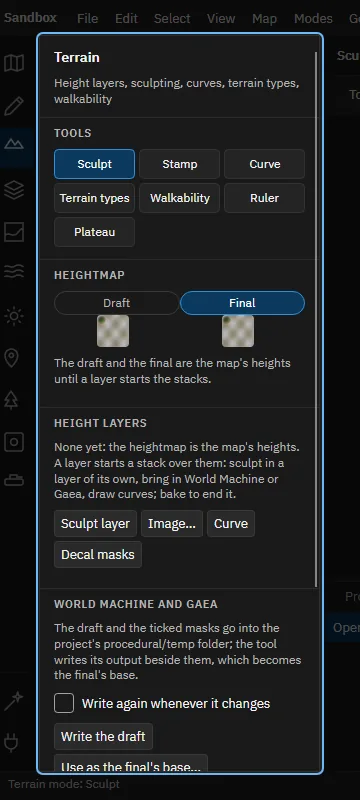

What the mode has: its tools first, then what it works on, the height layers here. Choose an entry to edit it in the inspector.

## 4. The tool's settings

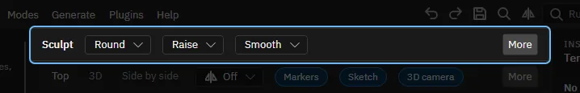

The active tool's settings in one row, the most used first. What does not fit the window lies behind More.

Brush settings are kept per tool. The keys [ and ] make a brush smaller and larger.

## 5. What the views show

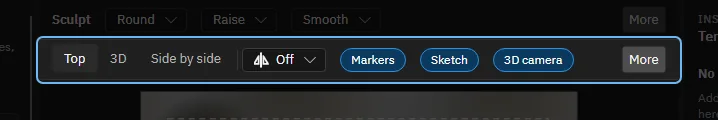

Top, 3D or both side by side, the map's symmetry, and a chip for each overlay: markers, path nodes, the 3D camera, and more behind More.

## 6. The top view

The map from above. The left mouse uses the tool, the right or middle mouse moves the map, the wheel zooms.

## 7. Try it: the 3D view

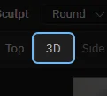

Click 3D, or press Ctrl+2.

> That is the 3D view. The wheel zooms towards the mouse, the middle mouse moves, space and the mouse turn the view. Both views share the camera.

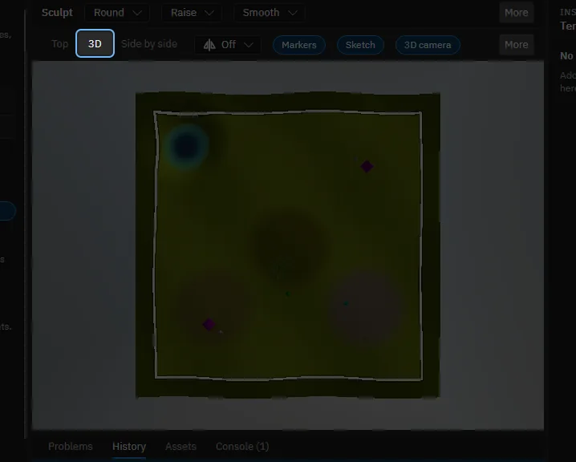

## 8. The dock

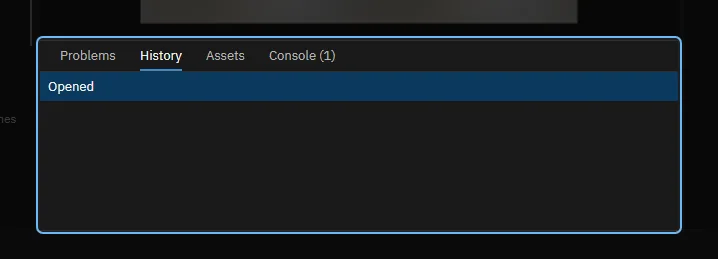

The problems the checks found, the history of undo steps, the workspace's assets to drag onto the map, and the Console.

## 9. The inspector

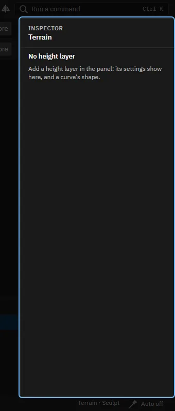

Edits what you chose last: an entry of the panel, things on the map, or an asset on the shelf.

## 10. The status bar

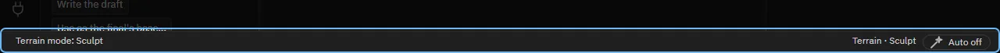

What the last operation did, the mode and tool, what is out of date, and the switch that makes results again on their own.

## 11. Every operation is a command

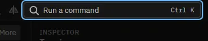

Ctrl+K finds any of them by name, with its shortcut. The menus hold the same commands.

## 12. That is the window

Next: the tours of the modes, one for sketching a draft and one for each of Terrain, Masks, Paint, Markers, Units and Procedural. Help, Tours lists them and starts this one again.

Made with the map editor 1.0.0+0b2734474d350fcba68c3bdae8a6574fef65815c on 2026-10-13, window 1280 by 800, dark theme.
